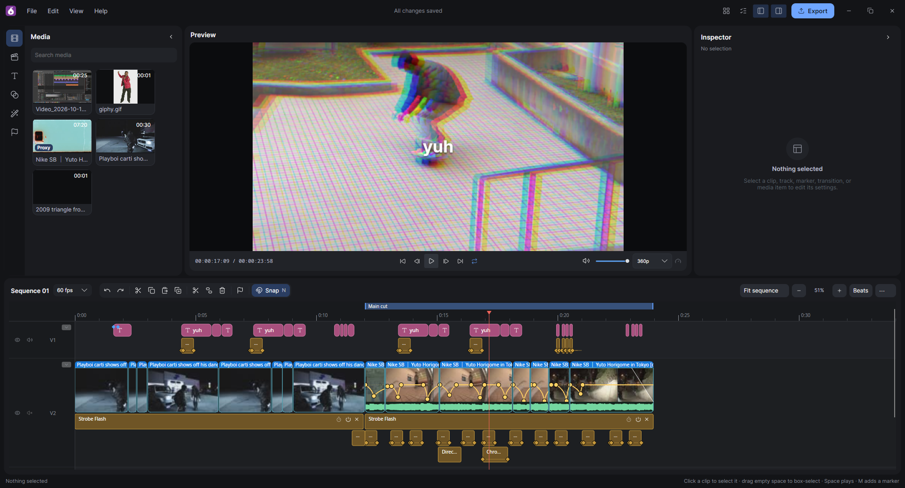

<p align="center">
  
</p>

<h1 align="center">Fig</h1>

<p align="center">
  <a href="https://github.com/Skynse/Fig/releases/latest"></a>
  <a href="https://github.com/Skynse/Fig/releases"></a>
  <a href="LICENSE"></a>
  
  
  
  
</p>

A simple, open-source video editor for cutting clips, long or short, without the hassle. Built with C# and Avalonia.



- **Timeline editing:** move, trim, split, ripple delete, with undo for everything.
- **Speed ramps:** keyframe a clip's speed, with frame blending or motion blur.
- **Effects and keyframes:** 30 effects, 20 transitions and presets, with any value keyframable. See the [creative library](docs/creative-library.md).
- **Text and layers:** titles and images, with tracks stacked top over bottom.
- **Markers:** bookmarks and ranges, and export each range as its own video.
- **Fast export:** H.264 / AAC, with hardware encoding where available.

## Install

Get the latest from [Releases](https://github.com/Skynse/Fig/releases). Each is a single file with everything included.

- **Windows:** run `Fig-<version>-win-x64-setup.exe` (no admin needed), or the portable `Fig-<version>-win-x64.exe`.
- **Linux:** `chmod +x Fig-<version>-linux-x64` and run it. It adds itself to your app menu. Run it with `--uninstall` to remove it from the menu.

## Build from source

Needs the .NET 10 SDK.

```bash
dotnet run --project src/Fig.App
dotnet test
```

See [DEVELOPMENT.md](DEVELOPMENT.md) for how things fit together and [CONTRIBUTING.md](CONTRIBUTING.md) before sending changes.

## License

[GPLv3](LICENSE)
